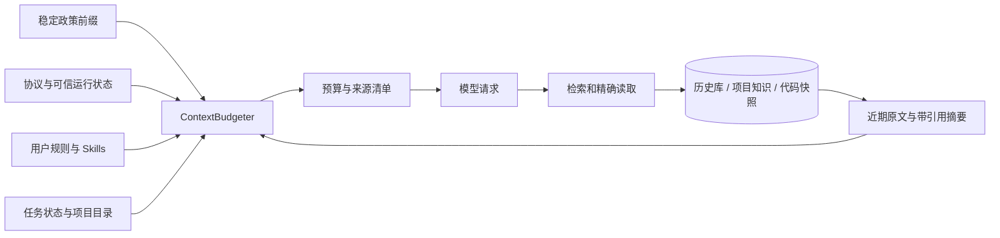

# 记忆系统与扩展接口

本轮重构采用应用管理的历史库、结构化任务状态、带来源版本的项目知识和可重建索引。工作区默认 `~/GenesisAI/workspace`；应用目录默认 `~/.genesisai`，由 `GENESISAI_HOME` 覆盖。应用不向用户项目创建管理目录；只读取用户自备的 `AGENTS.md`。

## 数据边界

```text
~/.genesisai/
  config.json                      终端模型配置；ENV 密钥优先
  AGENTS.md                        用户规则（可选）
  state/genesis.sqlite3             事务数据库
  assets/images/<sha256>.png        共享的不可变图片快照
  projects/<project_id>/
    mcp.json                       该项目的 MCP 配置
    skills/<name>/{skill.yaml,SKILL.md}
    workflows/<name>.md
  skills/<name>/                   用户级 Skill
  logs/<session_id>.jsonl           完整交互诊断日志，认证信息脱敏
  traces/<session_id>.jsonl         白名单执行元数据
  sources/                         网页来源缓存
  command_logs/                    命令输出
  backups/                         文件编辑备份
  evaluations/                     显式运行的验收报告
```

`GENESISAI_CONFIG_DIR` 和 `--config-dir` 是模型配置的独立覆盖项；不改变历史库位置。应用目录不可用时直接报告错误。没有旧 JSON 会话、旧项目目录和旧接口的迁移或兼容读取。

数据库使用当前 schema 版本，未知版本拒绝打开。采用 SQLite 回滚日志与短写事务；不依赖宿主 SQLite 的 WAL 特性。`Session.commit()` 使用 revision 比较防止过期实例覆盖，原始消息只追加。一次提交原子保存新增消息、工具调用状态及会话执行状态。读取清单与 `Session.inspect()` 不进行恢复；显式恢复将 running 标记 interrupted、started 调用标记 unknown，未知执行不自动重放。

| 数据 | 权威记录 | 可变与生命周期 |
| --- | --- | --- |
| 原始对话、工具状态变更 | `events` | 原始消息不可覆盖；完整原文可按 event 引用分页读取 |
| 会话执行状态、审批与恢复 | `sessions`、`calls`、`resources` | 事务更新；与项目知识分开 |
| 任务计划、验收、交接 | `tasks` | 按会话管理；重复工具结果不会重复记账 |
| 项目知识 | `notes`、`note_versions` | 来源、类型、状态、revision；修正需携带期望版本 |
| 历史代码快照 | `file_snapshots` | 内容哈希版本引用；索引变化不覆盖旧快照 |
| 当前文件结构 | `files` | 路径、哈希、符号、导入；可从工作区重建 |
| 全文检索 | `search_documents`、`search_fts` | 派生数据，可从原始记录重建 |
| 维护与诊断 | `jobs`、`context_manifests` | 任务状态、失败原因和每次上下文的来源清单 |

本地项目身份以规范化 Git common directory 为锚；同仓库的 worktree 共享 project_id，workspace_id 分离。独立目录和独立克隆分开。父仓库忽略的目录按独立工作区处理。移动项目或工作区不做隐式重绑定，避免悄悄把不同工程合并；用户需显式选择新目录并建立索引。

## 检索与事实有效性

默认只检索当前工作区的原文、代码与知识，以及显式 shared 的项目知识。同项目其他 worktree 的原始历史不自动开放。FTS5 trigram 支持长词检索，两个汉字等短词走显式字面匹配；当前不需要向量数据库或外部图服务。

模型通过三个内核工具访问库：`memory_search(query, corpus, limit)` 找引用；`memory_read(ref, offset, limit, revision)` 读原文；`memory_write(...)` 保存或修正知识。默认知识状态为 unverified，active 仍不能超越当前源码和验证证据。来源变化、删除或修正会沿知识依赖递归标记 stale，并从默认检索结果中撤下；旧条目和旧代码引用仍能精确读取。知识不能形成循环依赖。

代码索引在本次授权的输入和输出路径内扫描。项目目录、代码检索和按引用读取也会检查这个范围，包括以前在更宽授权下建立的快照。扫描遵守 Git 忽略列表，排除常见密钥文件、链接、构建与依赖目录，限制文件数与单文件大小。Python 解析器提取 AST 符号和导入，其他语言默认只有文件级信息。超出扫描范围会报告 partial。索引里的文本是历史快照，回答当前代码事实时仍需读取当前文件。

图片像素与对话分开，按哈希去重。历史引用可在同一工作区跨会话重新加载；其他工作区不可借引用读取。原始图片、元数据与请求图片预算继续校验；视频未接入。

## 上下文组装



请求窗口和最大输入配置默认统一为 **400000 tokens**。输出预留 4096、安全余量 1024，因此默认可用输入为 394880；模型返回的真实用量还会校准估算误差。400K 是应用配置，不是对所有供应商模型容量的断言；接口溢出会触发一次有界恢复，再失败则明确停止。

`history_tokens=32000` 用于当前用户消息以外的对话材料。当前输入按整个请求的剩余窗口计费。较早内容折叠成带来源范围的摘要，消息按时间顺序组织，工具调用及其结果整批处理。完整原文保留在事件库。复述追问需要查阅原文时，运行时只向模型提供声明了 `ToolSpec.history_lookup=True` 的本地只读工具。规则是必需块，超预算明确失败。可选项目目录超预算时，在 manifest 中标明省略原因。

稳定系统前缀只含应用政策。运行协议与运行状态单独组装；AGENTS.md 处于用户规则层，项目知识与检索资料是参考层，不能成为 system 指令。每个 ContextBlock 声明 source、scope、role、trust、token_budget 和 required；manifest 保存哈希、估算量与是否纳入。`/budget`、`/memory diagnostic` 可查看实际请求预算和来源清单。

## 注册扩展

五层依赖保持 `shared ← model ← agent ← core ← app`。`shared/session.py` 定义会话记录，`agent/ports.py` 定义执行循环需要的端口，core 负责持久化、记忆、工具和上下文实现。业务工具通过统一 Executor、审批和调用账本执行。

内置工具在 `core/extensions/tools/<category>/<name>/` 放入 `tool.yaml`、`spec.py`、`implementation.py`，注册表自动发现。安装包使用标准入口点：

```toml
[project.entry-points."genesisai.extensions"]
my_extension = "my_package:register"
```

```python
def register(runtime):
    runtime.register_tool(descriptor, implementation)
    runtime.register_context("my_source", provider, priority=50)
    runtime.register_parser(".xyz", parse_structure)
    runtime.register_prompt("my_protocol", prompt_path,
                            protocol="my_protocol", selector=matches_task)
    runtime.register_maintenance("my_index", rebuild_index)
    runtime.register_verifier("my_language", plan_verification)
```

注册只加载已安装的应用扩展，不自动执行用户项目内的 Python 模块。工具实现可以提供 `observe(args, payload)`，返回 `Observation`：resource_read、resource_changed 或 verification。任务记忆消费这些标准事实，不通过工具名猜测操作含义。新观察类型需要修改事实契约；通常新增工具可以使用现有类型。

Context provider 接受包含 session/runtime/profile 的 request，返回 ContextBlock 序列。自动验收也可用 register_verifier 注册规划函数，返回标准工具名和参数，仍经过同一审批管线。解析器接受源码字符串，返回 `symbols`、`imports`、`coverage`。新语言的推断质量由对应解析器负责。项目 MCP 配置进入同一工具执行管线；MCP 连接本身不因注册而启动。维护任务在调用模型前按有界数量处理，不另启智能体；独占应用宿主启动时把中断的派生任务重新排队。失败会保留诊断，不吞掉运行错误。

## 运维

`/project` 查看身份、任务和目录，`/project rebuild` 更新代码索引。`/memory` 支持 list、search、read（可指定历史版本）、write、delete、export、rebuild、diagnostic、backup。write 接受一个 JSON 文件，字段与 memory_write 相同。delete 先返回条目预览，显式追加 `--confirm` 才执行，且必须指定版本。它删除知识条目及版本、让关联条目失效，不删除原始会话。

`/memory backup 新文件` 使用 SQLite backup API 产生一致数据库副本；完整备份还需同时保存 assets 和所需日志。没有自动清理历史或图片。恢复备份、原文保留期限与垃圾回收应作为独立管理操作实现，不能在模型请求中悄悄删除资产。

## 设计依据与边界

采用“短目录 + 按需查阅”，参考 [Claude Code memory](https://code.claude.com/docs/en/memory#how-it-works)；结构索引参考 [Aider repository map](https://aider.chat/docs/repomap.html)；工作上下文与长期状态分开参考 [Anthropic context engineering](https://www.anthropic.com/research/effective-context-engineering-for-ai-agents)。稳定前缀参考 [OpenAI prompt caching](https://developers.openai.com/cookbook/examples/prompt_caching_201#42-stabilize-the-prefix)。本地事务与派生全文索引依据 [SQLite 使用场景](https://sqlite.org/whentouse.html) 和 [FTS5](https://sqlite.org/fts5.html)。本机 Cline Python 与 DeepSeek Harness 的会话保存、压缩投影和按范围查阅机制也作为实现对照。

当前提供可追溯的词法检索、来源依赖失效和 Python 结构图基础，不声称具备通用语义图推理、全语言调用图或完美回忆。后续向量召回、更多语言解析器和维护策略可通过相应注册点加入；当前原文、身份、版本与权限边界不依赖这些算法。
