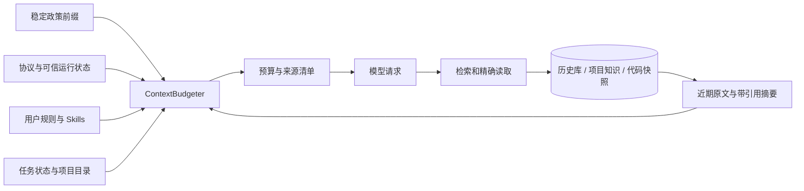

# 记忆系统与扩展接口

当前实现采用应用管理的历史库、结构化任务状态、带来源版本的项目知识和可重建索引。应用目录默认 `~/.genesisai`，可用 `GENESISAI_HOME` 覆盖。默认工作区是应用目录下的 `workspace`。工具可在该子目录中处理任务文件，配置、历史库和附件由应用单独管理。应用读取用户级、工作区根目录及操作路径对应目录作用域内的可选 `AGENTS.md`。文档职责与历史资料入口见[文档导航](README.md)。

## 数据边界

```text
~/.genesisai/
  workspace/                       默认任务工作区
  config.json                      终端模型配置；ENV 密钥优先
  AGENTS.md                        用户规则（可选）
  state/genesis.sqlite3             事务数据库
  assets/images/                   图片视图、元数据及 originals/ 原图
  projects/<project_id>/
    lsp.json                       项目语言服务配置
    index.json                     项目索引配置
    lsp-results/                   语言查询状态与分页结果
    workflows/<name>.md
  capabilities/
    library.sqlite3                草稿、不可变修订、测试报告、验收注册
    assets/                        按哈希保存的实现、夹具及结果资产
    bundles/<id>/<revision>/       经完整性检查的执行包
    tests/<report_id>/             测试工作目录和诊断日志
    trials/<trial_id>/             用户试用工作目录
    runs/                         已注册 Tool 调用日志
  logs/<session_id>.jsonl           完整交互诊断日志，认证信息脱敏
  traces/<session_id>.jsonl         白名单执行元数据
  sources/                         网页来源缓存
  jobs/<session_id>/<job_id>/       独立作业状态、分段输出和结果
  jobs/limits.json                 作业并发、日志、结果及输入配额
  maintenance/limits.json          后台维护并发配置
  backups/                         文件编辑备份
  evaluations/                     显式运行的验收报告
```

`GENESISAI_CONFIG_DIR` 和 `--config-dir` 是模型配置的独立覆盖项；不改变历史库位置。应用目录不可用时直接报告错误。没有旧 JSON 会话、旧项目目录和旧接口的迁移或兼容读取。

数据库使用当前 schema 版本，未知版本拒绝打开。采用 SQLite 回滚日志与短写事务；不依赖宿主 SQLite 的 WAL 特性。`Session.commit()` 使用 revision 比较防止过期实例覆盖，原始消息只追加。一次提交原子保存新增消息、工具调用状态及会话执行状态。读取清单与 `Session.inspect()` 不进行恢复；显式恢复将 running 标记 interrupted、started 调用标记 unknown，未知执行不自动重放。

| 数据 | 权威记录 | 可变与生命周期 |
| --- | --- | --- |
| 原始对话、工具状态变更 | `events` | 原始消息不可覆盖；完整原文可按 event 引用分页读取 |
| 会话执行状态、审批与恢复 | `sessions`、`calls`、`resources` | 事务更新；与项目知识分开 |
| 任务目标、约束、计划、验收、交接 | `tasks` | schema_version=2；任务 revision 防并发覆盖，plan_revision 防过期计划更新；重复工具结果不重复记账 |
| 项目知识 | `notes`、`note_versions` | 来源、类型、状态、revision；修正需携带期望版本 |
| 历史代码快照 | `file_snapshots` | 内容哈希版本引用；索引变化不覆盖旧快照 |
| 当前文件结构 | `files` | 路径、哈希、符号、导入；可从工作区重建 |
| 全文检索 | `search_documents`、`search_fts` | 派生数据，可从原始记录重建 |
| 维护与诊断 | `jobs`、`context_manifests` | 任务状态、失败原因和每次上下文的来源清单 |

本地项目身份以规范化 Git common directory 为锚；同仓库的 worktree 共享 project_id，workspace_id 分离。独立目录和独立克隆分开。父仓库忽略的目录按独立工作区处理。移动项目或工作区不做隐式重绑定，避免悄悄把不同工程合并；用户需显式选择新目录并建立索引。

任务账本保留完整 objective、instructions、带来源和作用域的 constraints、阶段树 nodes、实际 observed_calls 和完整 handoff。一次 Run 结束不代表任务完成；讨论可独立交付回答，同时保持原执行目标与未完成项。约束由宿主从用户指令登记，plan 不能修改授权；turn 作用域只在对应 Run 生效，task 作用域持续到撤销或任务结束。当前格式以外的任务记录拒绝使用，不自动迁移或删除。

计划通过 plan 工具按节点 ID 和 expected_revision 增量更新，完整记录可分页读取。完成证据必须来自当前任务实际成功的调用；要求验证的节点核对修改版本，旧文件哈希或变更前测试不能充当当前证据。通过一次验证仍保持未完成阶段；修改及外部文件变化使相关证据失效。失败验证跨 Run 保存，不会因普通读取或新消息而消失。已结束的任务不因后续文件变化重新开启。

## 检索与事实有效性

默认只检索当前工作区的原文、代码与知识，以及显式 shared 的项目知识。同项目其他 worktree 的原始历史不自动开放。FTS5 trigram 支持长词检索，两个汉字等短词走显式字面匹配；当前不需要向量数据库或外部图服务。

模型通过三个内核工具访问库：`memory_search(query, corpus, limit)` 找引用；`memory_read(ref, offset, limit, revision)` 读原文；`memory_write(...)` 保存或修正知识。默认知识状态为 unverified，active 仍不能超越当前源码和验证证据。来源变化、删除或修正会沿知识依赖递归标记 stale，并从默认检索结果中撤下；旧条目和旧代码引用仍能精确读取。知识不能形成循环依赖。

`memory_read` 的页面由请求预算器动态分配：取校准后模型输入容量的八分之一和最近请求剩余空间的一半中的较小值，预留摘要空间，最低512估算Token；正文仍最多20万字符。实际页面计算包含JSON双层转义与结果信封开销；不足以容纳元数据时明确报错。返回 total_chars 和实际 next_offset，游标始终按原文字符计数。工具结果展示容量同步调整，避免正常大页再次被截成另一层存档预览。版本、工作区隔离和完整原文均不受分页影响。

代码索引在本次授权的输入和输出路径内扫描。项目目录、代码检索和按引用读取也会检查这个范围，包括以前在更宽授权下建立的快照。扫描遵守 Git 忽略列表，排除常见密钥文件、链接、构建与依赖目录；取消固定文件数量和文本前缀截断，保留完整历史快照。Python 解析器提取 AST 符号和导入，其他语言默认只有文件级信息。索引里的文本是历史快照，回答当前代码事实时仍需读取当前文件。

项目上下文先按当前请求和任务目标检索知识/源码，再补充目录入口；查询词的选取范围明确记在目录元数据中，完整目标仍在任务账本。目录按 context.project_context_tokens 预算逐项选择，每项保留精确引用，片段放不下时只保留引用。全请求预算不足时继续逐项省略可选块，并在 manifest 记录 request_budget 原因；必需的用户指令与任务约束不参与可选裁剪。未列出的项目内容仍可通过 memory_search 分页检索或 list_files 浏览，memory_read 读取全文。

生成摘要的请求上限使用 context.summary_max_tokens，并受本次可用上下文约束；返回摘要不再二次裁到6000字符。基础摘要和历史工具预览仍只提供入口，保留原文引用及省略提示，任务目标、约束和未完成项以独立账本为准。

最新完整工具批次与当前用户请求一起计入必要上下文，不占用旧历史额度；最新图片读取的像素还单独按视觉预算分配。这样大页刚读取成功时，不会在模型看到内容和游标前就被历史压缩折叠。旧工具结果仍可归档，工具调用与全部返回保持成对。

图片像素与对话分开，按哈希去重。历史引用可在同一工作区跨会话重新加载；其他工作区不可借引用读取。原始图片、元数据与请求图片预算继续校验。模型消息当前只承载文字与静态图片；本地音视频通过抽帧、音轨提取和可选转写工具产生图片或文字，详见[本地文档与媒体能力](本地文档与媒体能力.md)。

## 上下文组装



请求窗口和最大输入配置默认统一为 **400000 tokens**。输出预留 4096、安全余量 1024，因此默认可用输入为 394880；模型返回的真实用量还会校准估算误差。400K 是应用配置，不是对所有供应商模型容量的断言。接口溢出后重新投影上下文，只有请求实际缩小才重试；必要上下文无法继续缩小时明确停止，适用的任务预算继续生效。

`history_tokens=32000` 用于较早的对话材料，当前用户输入及最新完整工具批次计入整个请求的剩余窗口。较早内容折叠成带来源范围的摘要，消息按时间顺序组织，工具调用及其结果整批处理。完整原文保留在事件库。复述追问时，工具选择器优先保留声明了 `ToolSpec.history_lookup=True` 的工具，其他工具仍可按任务、Skill 或显式发现选入；实际执行继续受权限与任务约束限制。规则是必需块，超预算明确失败。可选项目目录超预算时，在 manifest 中标明省略原因。

稳定系统前缀只含应用政策。运行协议与运行状态单独组装；AGENTS.md 处于用户规则层，项目知识与检索资料是参考层，不能成为 system 指令。每个 ContextBlock 声明 source、scope、role、trust、token_budget 和 required；manifest 保存哈希、估算量与是否纳入。`/budget`、`/memory diagnostic` 可查看实际请求预算和来源清单。

## 注册扩展

能力目录首先分为 `builtin` 和 `external`，其中包含 Tool、Skill、MCP。外挂包声明 `scope=user|project`，注册投影保留 source、scope、provider，MCP 工具保留服务归属。不存在用户／项目／内置的隐式覆盖顺序。

面向用户的内置接口为 `create_tool/create_skill/create_mcp`、`revise_capability`、`freeze_capability`、`test_capability`、`try_capability`、`read_capability_artifact`、`register_capability` 和 `inspect_capabilities`。包是严格纯数据 JSON，含 kind、name、description、scope、definition、files、tests；实现不导入宿主进程。独立 SQLite 能力库用事务记录不可变修订、摘要、实际报告和接受记录。注册同时验证当前修订、摘要、报告编号及 Executor 的宿主验收上下文；模型无法通过普通参数声明已验收。已注册版本的文件被改动后退出运行目录并提供诊断。

测试按用例创建工作目录。Tool 子进程从 stdin 读取 JSON 参数，将唯一 JSON 结果写入 `GENESISAI_RESULT_PATH`，stdout/stderr 仅作为日志；Skill 顺序启动带阶段依赖白名单的独立 Runner，使用独立 Session 与新 MCP 连接；MCP 按明确的传输配置执行发现及真实调用。过程不提供操作系统安全沙盒。MCP 的 `env_from` 和 `headers_from` 只保存环境变量名，实际凭据由宿主运行时解析。包内代码固定，宿主依赖及远端服务行为不做版本冻结。结果通道、阶段依赖和试用隔离见[外挂结果通道与阶段 Skill](外挂结果通道与阶段Skill.md)，用户流程见[用户指南](用户指南.md#创建测试与注册外挂)。

五层依赖保持 `shared ← model ← agent ← core ← app`。`shared/session.py` 定义会话记录，`agent/ports.py` 定义执行循环需要的端口，core 负责持久化、记忆、工具和上下文实现。业务工具通过统一 Executor、审批和调用账本执行。

内置工具在 `core/extensions/tools/<category>/<name>/` 放入 `tool.yaml`、`spec.py`、`implementation.py`，注册表自动发现。安装包使用标准入口点：

```toml
[project.entry-points."genesisai.extensions"]
my_extension = "my_package:register"
```

```python
def register(runtime):
    runtime.register_tool(descriptor, implementation)
    runtime.register_context("my_source", provider, priority=50)
    runtime.register_parser(".xyz", parse_structure)
    runtime.register_prompt("my_protocol", prompt_path,
                            protocol="my_protocol", selector=matches_task)
    runtime.register_maintenance("my_index", rebuild_index)
    runtime.register_verifier("my_language", plan_verification)
```

上述 Python 入口点是宿主开发者安装的扩展 SDK，注册的工具归为外挂；它能扩展解析器、上下文等宿主服务，与用户纯数据能力包属于不同接入层。它只加载已安装的应用扩展，不自动执行用户项目内的 Python 模块。工具实现可以提供 `observe(args, payload)`，返回 `Observation`：resource_read、resource_changed 或 verification。任务记忆消费这些标准事实，不通过工具名猜测操作含义。新观察类型需要修改事实契约；通常新增工具可以使用现有类型。

工具在 `ToolSpec.routes` 声明适用的任务或协议标签，例如 `("coding",)`。没有标签的工具可通过名称、Skill 或 `discover_tools` 选入本次运行。同步调用的 `timeout_seconds` 约束前台处理；声明 `execution="job"` 的工具经预览和授权后进入独立作业，作业寿命由可选 `execution_timeout_seconds` 单独控制。命令、MCP 和能力测试还通过宿主服务提交各自作业，不能把前台短等窗口当成总执行时限。工具实例按次执行，跨调用状态通过会话或宿主服务保存，宿主保管审批与持久连接。已发送到外部系统的操作可能继续生效。`max_output_chars` 限制返回模型的文本投影，完整返回值在当前工作区作用域内按引用查询。需要提交最终回答的工具通过 `completion_field` 指向结果中的文字字段；Runner 执行统一验收，未收取或结果未知的必需作业阻止完成。

Context provider 接受包含 session/runtime/profile 的 request，返回 ContextBlock 序列。开发任务验收可用 register_verifier 注册规划函数，返回标准工具名和参数，仍经过同一审批管线；外挂注册的用户验收不能由 verifier 代替。解析器接受源码字符串，返回 `symbols`、`imports`、`coverage`。新语言的推断质量由对应解析器负责。已验收的 MCP 定义进入同一工具执行管线；正式连接不因注册而启动。维护由独立后台服务推进，共享全局执行槽位并受维护池并发配置约束，不依赖模型轮次；独占应用宿主启动时把中断的派生任务重新排队，用户明确取消的任务保持取消。失败会保留诊断，不吞掉运行错误。

## 运维

`/project` 查看身份、任务和目录，`/project rebuild` 更新代码索引。`/memory` 支持 list、search、read（可指定历史版本）、write、delete、export、rebuild、diagnostic、backup。write 接受一个 JSON 文件，字段与 memory_write 相同。delete 先返回条目预览，显式追加 `--confirm` 才执行，且必须指定版本。它删除知识条目及版本、让关联条目失效，不删除原始会话。

`/memory backup 新文件` 使用 SQLite backup API 产生一致数据库副本；完整备份还需同时保存 assets 和所需日志。没有自动清理历史或图片。恢复备份、原文保留期限与垃圾回收应作为独立管理操作实现，不能在模型请求中悄悄删除资产。

## 设计依据与边界

采用“短目录 + 按需查阅”，参考 [Claude Code memory](https://code.claude.com/docs/en/memory#how-it-works)；结构索引参考 [Aider repository map](https://aider.chat/docs/repomap.html)；工作上下文与长期状态分开参考 [Anthropic context engineering](https://www.anthropic.com/research/effective-context-engineering-for-ai-agents)。稳定前缀参考 [OpenAI prompt caching](https://developers.openai.com/cookbook/examples/prompt_caching_201#42-stabilize-the-prefix)。本地事务与派生全文索引依据 [SQLite 使用场景](https://sqlite.org/whentouse.html) 和 [FTS5](https://sqlite.org/fts5.html)。本机 Cline Python 与 DeepSeek Harness 的会话保存、压缩投影和按范围查阅机制也作为实现对照。

当前提供可追溯的词法检索、来源依赖失效和 Python 结构图基础，不声称具备通用语义图推理、全语言调用图或完美回忆。后续向量召回、更多语言解析器和维护策略可通过相应注册点加入；当前原文、身份、版本与权限边界不依赖这些算法。
